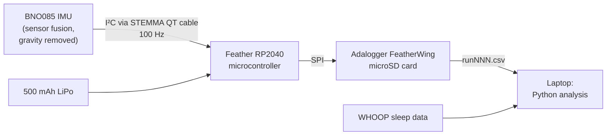
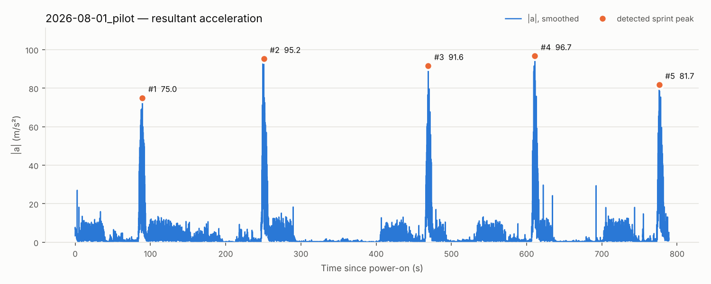
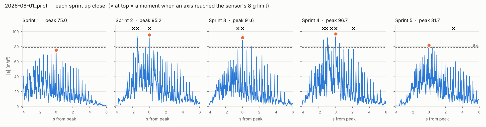

# Sleep & Sprint Sensor

**A self-built wearable accelerometer and an n-of-1 study of how sleep affects sprint acceleration.**

I'm a high school sprinter, and I wanted to know whether the way I sleep actually changes how hard I accelerate out of the start. Nothing I could buy answered that, so I built a waist-worn logger that records acceleration at 100 Hz to a microSD card and designed a study that pairs each sprint session with the previous night's sleep data from my WHOOP strap.

> **Project status (October 2026):** The device is built, bench-tested, and completed one pilot field session on August 1, 2026. Formal data collection is **paused while I recover from an injury** and will resume once I'm cleared to sprint. No study results are reported yet; the [pilot data](#pilot-session-august-1-2026) and what it revealed are below.

---

## Contents

- [How it works](#how-it-works)
- [Hardware](#hardware)
- [Firmware](#firmware)
- [Study design](#study-design)
- [Pilot session](#pilot-session-august-1-2026)
- [Data and analysis](#data-and-analysis)
- [Development story](#development-story)
- [Repository layout](#repository-layout)
- [Roadmap](#roadmap)
- [Acknowledgments](#acknowledgments)
- [License](#license)

---

## How it works



1. The **BNO085** fuses its accelerometer, gyroscope and magnetometer on-chip and reports **linear acceleration** (gravity already subtracted) in m/s² on three axes.
2. The **Feather RP2040** requests a reading every 10 ms (100 Hz) and writes each one as a CSV row: `time_ms, x, y, z`.
3. Rows go to a **microSD card** on a stacked Adalogger FeatherWing. Every power-up starts a new file (`run000.csv`, `run001.csv`, …), so nothing is overwritten.
4. After a session I copy the file to my laptop. A Python script computes the **resultant acceleration** (the magnitude of the 3-axis vector)
   `|a| = √(x² + y² + z²)`, finds each sprint's peak, and pairs the session with that night's WHOOP metrics.

I use the resultant rather than any single axis because it doesn't depend on how the sensor is rotated on my body, which inevitably changes a little between sessions.


*Feather RP2040 + Adalogger stack (left), BNO085 sensor (right), 500 mAh LiPo (top, shown unplugged).*

---

## Hardware

| Part | Adafruit ID | Role |
|---|---|---|
| Feather RP2040 | 4884 | Microcontroller, USB-C, LiPo charger |
| 9-DOF IMU Fusion Breakout – BNO085 (STEMMA QT) | 4754 | Motion sensor, ±8 g accelerometer range |
| Adalogger FeatherWing (RTC + microSD) | 2922 | Data storage (+ real-time clock for future timestamps) |
| STEMMA QT / Qwiic JST-SH cable, 100 mm | — | Sensor ↔ Feather, click-in on both ends |
| Short Feather female headers (12 + 16 pin) | 2940 | Socket for stacking the Adalogger |
| Male header strip (included with Feather) | — | Stacking pins on the Feather |
| LiPo battery 3.7 V 500 mAh | 1578 | Portable power |
| CR1220 coin cell | 380 | Adalogger RTC backup |
| microSD card, 16 GB, FAT32 | — | Storage |

**Approximate cost:** about $60 in parts.

Full assembly steps, wiring, and mounting notes are in **[docs/hardware.md](docs/hardware.md)**.

---

## Firmware

The logger sketch is [`firmware/sprint_logger/sprint_logger.ino`](firmware/sprint_logger/sprint_logger.ino) (Arduino, Earle Philhower RP2040 core + Adafruit BNO08x library). It:

- starts the BNO085 over I²C and requests linear acceleration at 100 Hz,
- re-enables the report automatically if the sensor ever resets,
- opens the next unused `runNNN.csv` on the SD card and writes a header row,
- logs every sample and flushes to the card once per second, so at most ~1 s is lost if power is cut.

The device records whenever it has power, so a session is simply: connect the battery → sprint → disconnect.

Setup, upload instructions and the two bring-up test sketches are in **[firmware/README.md](firmware/README.md)**.

---

## Study design

A prospective **n-of-1 observational study** (I am the only participant). The full pre-specified protocol is in **[docs/study-protocol.md](docs/study-protocol.md)**. In short:

| | |
|---|---|
| **Question** | Do nightly sleep metrics predict next-day peak sprint acceleration? |
| **Sessions** | 3 per week; target 8 weeks (24 sessions), minimum 4 weeks (12) |
| **Per session** | Standardized warm-up, then 5 × 30 m sprints, same lane, 3–4 min rest |
| **Outcome** | Peak resultant acceleration per sprint; session score = mean of the top 3 of 5 *(under review after the pilot)* |
| **Predictors (WHOOP)** | Sleep duration, sleep performance %, recovery %, HRV, resting heart rate |
| **Logged confounds** | Time of day, temperature, wind, surface, soreness, prior-day training load |

I'm committing to report whatever the data show, including a null result. With one participant and a short window, a weak or absent relationship is a real possibility.

---

## Pilot session (August 1, 2026)

One field session to test the device, the mount, and the session procedure before the study. The device was taped to the front of my shorts waistband, and I ran 5 × 30 m maximal sprints with walking recovery. The pilot is not part of the study data. Raw file: [`data/raw/2026-08-01_pilot.csv`](data/raw/2026-08-01_pilot.csv).


*Pilot mount: Feather stack and battery (left) and BNO085 sensor (right), taped to the front waistband.*





| | |
|---|---|
| Recording length | 13 min 9 s, 78,977 samples |
| Sample rate | 100 Hz; 17 brief gaps, none longer than 35 ms |
| Sprints detected | 5 of 5 |
| Peak resultant acceleration, sprints 1–5 | 75.0, 95.2, 91.6, 96.7, 81.7 m/s² (7.6–9.9 g) |
| Session score (mean of top 3) | 94.5 m/s² |
| Samples with an axis at the 8 g limit | 13, all during sprints 2–5 |

**What the pilot showed**

- **The device works in the field.** It logged to the SD card continuously for 13 minutes, and every sprint stands out clearly from the walking and standing around it. Individual foot strikes appear as separate spikes.
- **The peaks are foot-strike impacts, and they reach the sensor's limit.** The highest values in each sprint are the sharp spikes when a foot hits the track, not the smoother forward push. In sprints 2–5, at least one axis reached the BNO085's ±8 g ceiling, so the real impact was at least as large as recorded and possibly larger. That means the planned outcome, peak resultant acceleration, is partly capped by the sensor.
- **The mount may add to the spikes.** Tape on a shorts waistband lets the sensor move slightly against the body, which can exaggerate impact spikes.

**To decide before session 1**

1. An outcome less dominated by impact spikes, such as the average resultant acceleration over the first seconds of each sprint, or a filter that removes foot-strike spikes before finding the peak.
2. A higher-range accelerometer (±16 g or more), either alongside the BNO085 or instead of it.
3. A firmer mount, such as an elastic belt at the lower back.

Whatever I choose will go in the protocol's [change log](docs/study-protocol.md#change-log) before data collection resumes, so the decision is made before any study data exist.

---

## Data and analysis

- **Raw data:** `data/raw/` — one CSV per session, renamed `YYYY-MM-DD_sNN.csv`. Column definitions and naming rules are in [data/README.md](data/README.md).
- **Session log:** `data/session_log.csv` — WHOOP metrics and confounds, one row per session (template provided).
- **Analysis:** `analysis/compute_peaks.py` extracts sprint peaks and plots every session; `analysis/correlate_sleep.py` joins peaks with the session log and computes correlations. See [analysis/README.md](analysis/README.md).

```bash
pip install -r analysis/requirements.txt
python analysis/compute_peaks.py      # -> data/processed/peaks_summary.csv + figures/
python analysis/correlate_sleep.py    # -> data/processed/correlations.csv + figures/
```

The pilot file is already in `data/raw/`. Study data will be added as it is collected. Every session file will be published, not just the good ones.

---

## Development story

Getting a reliable 100 Hz stream took over a month and three hardware configurations. The short version: my first build (ESP32 + a clone BNO08x breakout) would detect the sensor but stall within seconds of streaming. After ruling out soldering, wiring, and the sensor board itself, the failure pattern matched a documented incompatibility between the classic ESP32's I²C hardware and the BNO08x's clock stretching. Switching to an RP2040 microcontroller fixed it on the first try: 30 minutes at a steady 100 samples/s with no stalls.

The full log of what broke, what I tested, and what I learned is in **[docs/development-log.md](docs/development-log.md)**.

---

## Repository layout

```
Sprint-Start-Sensor/
├── README.md                  ← you are here
├── docs/
│   ├── hardware.md            ← parts, assembly, wiring, mounting
│   ├── study-protocol.md      ← pre-specified study design
│   └── development-log.md     ← build history and debugging notes
├── firmware/
│   ├── README.md              ← IDE setup, upload, usage
│   ├── sprint_logger/         ← the field logger (100 Hz → microSD)
│   └── tests/                 ← sensor and SD bring-up sketches
├── analysis/
│   ├── README.md
│   ├── requirements.txt
│   ├── compute_peaks.py
│   └── correlate_sleep.py
├── data/
│   ├── README.md              ← file naming and column definitions
│   ├── session_log_template.csv
│   ├── raw/                   ← session CSVs from the SD card
│   └── processed/             ← script outputs
├── figures/                   ← generated plots
└── images/                    ← photos of the device
```

---

## Roadmap

- [x] Build and bench-test the logger (100 Hz, 30+ min continuous)
- [x] Portable version: battery + microSD logging
- [x] Pilot field session (August 1, 2026)
- [ ] Choose the final outcome measure, sensor range, and mount based on the pilot
- [ ] Resume data collection after injury recovery
- [ ] Use the Adalogger's real-time clock to stamp files with date and time
- [ ] Add a start/stop button so files contain only the session
- [ ] Add hand-timed or video-timed 30 m splits as a validation measure
- [ ] Write up results and post as a preprint

---

## Acknowledgments

I used an AI assistant (Claude, by Anthropic) for help writing the firmware and analysis code, troubleshooting the hardware, and getting feedback on the study design. I chose and bought the parts, soldered and assembled the device, ran the bench and field tests, made the final design decisions, and am responsible for the data collection, analysis, and conclusions.

---

## License

Code is released under the [MIT License](LICENSE). Data in `data/` is released under [CC BY 4.0](https://creativecommons.org/licenses/by/4.0/).

**Author:** Maximo Mann
