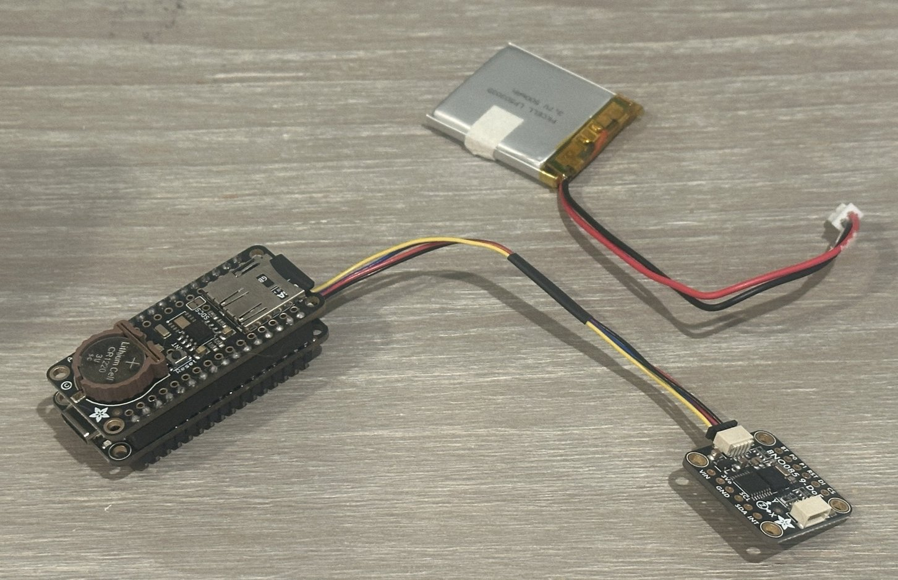
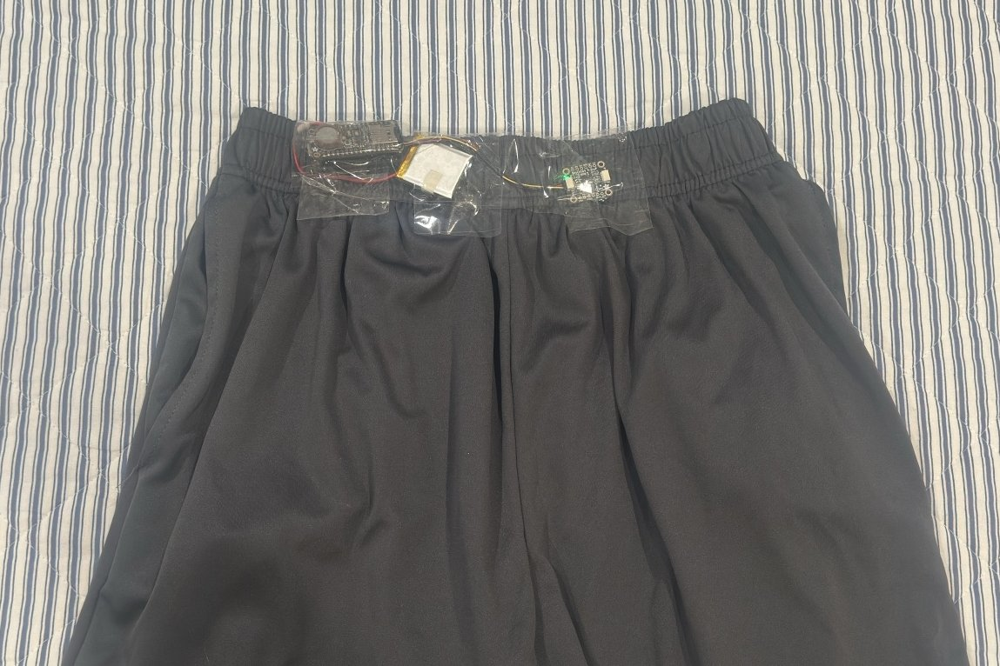

# Hardware

This page documents the final (third) version of the device. Earlier versions and why they were abandoned are described in [development-log.md](development-log.md).

## Bill of materials

| Qty | Part | Adafruit ID | Notes |
|---|---|---|---|
| 1 | Feather RP2040 | 4884 | Ships with a male header strip |
| 1 | 9-DOF Orientation IMU Fusion Breakout – BNO085 (STEMMA QT / Qwiic) | 4754 | Default I²C address 0x4A |
| 1 | Adalogger FeatherWing – RTC + microSD | 2922 | PCF8523 RTC, microSD socket |
| 1 | STEMMA QT / Qwiic JST-SH 4-pin cable, 100 mm | — | Plugs on both ends |
| 1 | Short Feather female header kit (12 + 16 pin) | 2940 | Soldered to the Adalogger |
| 1 | Male header strip (12 + 16 pins) | — | Included with the Feather |
| 1 | Lithium-ion polymer battery 3.7 V 500 mAh (JST-PH) | 1578 | Charges through the Feather's USB-C |
| 1 | CR1220 3 V coin cell | 380 | Required by the RTC |
| 1 | microSD card, 16 GB | — | Formatted FAT32 (cards ≤ 32 GB work out of the box) |

Tools: soldering iron, solder, a solderless breadboard (used as a jig to hold header pins straight while soldering).

## Key specifications

| | |
|---|---|
| Sample rate | 100 Hz (10 ms report interval), verified at 100 samples/s over 30 min |
| Measured quantity | Linear acceleration (gravity removed by the BNO085's on-chip sensor fusion), m/s², 3 axes |
| Accelerometer range | ±8 g (≈ ±78 m/s²) per axis; the pilot showed sprint foot strikes reach this limit |
| Storage | CSV on microSD, one file per power-up |
| Power | 500 mAh LiPo; estimated ≥ 4 h of logging (not yet measured) |

## Connections

There is no loose wiring in the final build.

| Link | Bus | Details |
|---|---|---|
| BNO085 → Feather | I²C | STEMMA QT cable between the two boards' STEMMA QT jacks. Sensor at address `0x4A`. |
| Adalogger RTC → Feather | I²C (shared) | Through the stacking headers. PCF8523 at address `0x68`, so it does not conflict with the sensor. Not used by the current firmware. |
| Adalogger microSD → Feather | SPI | Through the stacking headers. Chip select on **D10**. |
| Battery → Feather | — | JST-PH battery jack next to the USB-C port. |

> ⚠️ The Feather has two small white connectors. The **STEMMA QT** jack (for the sensor) is on the end labeled SDA/SCL. The **battery** jack (JST-PH, larger) is next to USB-C. Don't mix them up.

## Assembly

### 1. Adalogger FeatherWing (female headers)

1. Install the CR1220 coin cell in the holder, **+ side up**.
2. Push the short female headers up through the **outer row** of holes from the **bottom** of the board, so the black sockets hang underneath and the pins poke through the top. (The inner row of holes is a prototyping area; leave it empty.)
3. Solder all 28 pins from the top side.

### 2. Feather RP2040 (male headers)

1. Push the male header strips into the **outer row** of holes from the bottom, so the black plastic spacer sits **under** the board and the **long ends point up** through the top.
2. Rest the Feather on a breadboard with the pins inserted. This holds them straight and keeps the plastic spacer flush.
3. Solder all 28 pins on the top side where the pins meet the copper pads.

> **Lesson learned:** I first tried Adafruit's *short* male headers. They did not insert far enough into the short female sockets to hold the stack securely, so I switched to the standard-height male headers that come with the Feather. Do a dry fit before soldering.

### 3. Stack and connect

1. Press the Adalogger onto the Feather so the **pin labels on both boards line up** (e.g. SCL above SCL) and the USB-C port stays accessible.
2. Insert the microSD card (contacts toward the board) until it clicks.
3. Click the STEMMA QT cable into the Feather's STEMMA QT jack and either jack on the BNO085.
4. Plug in the battery last, only once everything has been tested over USB.

### 4. Bring-up order

Test one layer at a time, over USB, before adding the next. The sketches are in [`firmware/tests/`](../firmware/tests/).

1. Feather + sensor → `sensor_stream_test` should report ~100 samples/s with 0 resets.
2. Stack the Adalogger → `sd_card_test` should print "SD card detected!" and create `test.txt`.
3. Upload `sprint_logger` → check that `run000.csv` appears on the card.
4. Connect the battery and repeat step 3 untethered.

## Charging

Plug the battery into the Feather and connect USB-C to a computer or wall charger. The Feather's charge LED lights while charging and turns off when full (roughly 2–3 h from empty for 500 mAh). The device also logs while charging, so either remove the SD card or delete the extra files afterward.

## Mounting

For the pilot session, the device was **taped to the front of the waistband of my sprint shorts**: the Feather stack and battery on one side, and the BNO085 sensor a few inches to the other side, joined by the STEMMA QT cable. That keeps it at waist level, near the body's center of mass. Most published sprint IMU studies mount the sensor on the lower back instead; I used the front for the pilot, and whichever position the study uses, it will be the same every session.

Tape is quick and keeps the sensor from sliding, but a shorts waistband can shift slightly relative to the body during a sprint. In the pilot, foot-strike spikes reached the sensor's 8 g limit, and the tape mount may have exaggerated them. A firmer mount (such as an elastic belt at the lower back) is under consideration; whichever mount the study uses will be identical every session.

Rules for consistent data:

- The sensor must sit **tight against the body**. Any bounce or wobble shows up as fake acceleration.
- Mount it in the **same position and orientation** every session (mark "up" and "forward" on the case).
- Keep the STEMMA QT cable short and secured so it can't snag.
- The analysis uses **resultant acceleration** (the magnitude of the x, y, z vector), which is unaffected by small rotations of the sensor between sessions.
